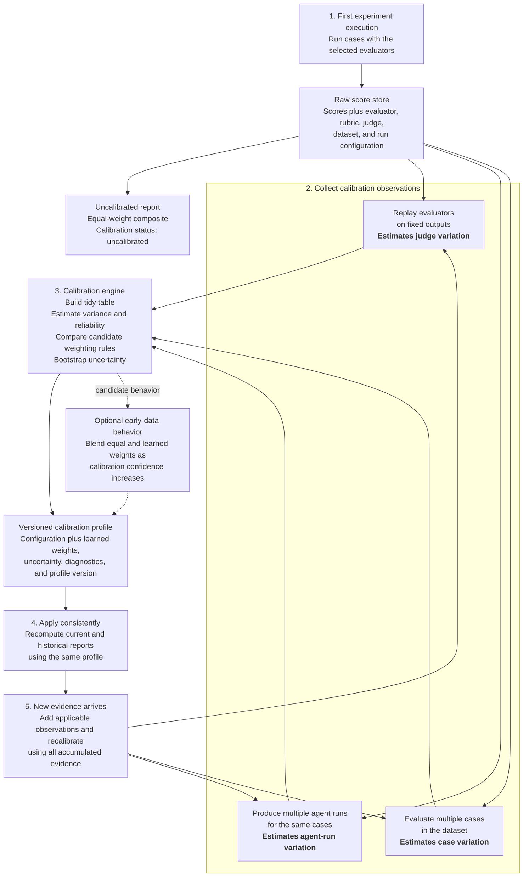

# Customer Calibration Workflow Diagram

## One-Sentence Interpretation

The first report uses an equal-weight fallback, while repeated evaluator and agent observations allow
the system to learn, version, and continuously improve an experiment-specific calibration profile
that can be applied consistently to both current and historical scores.

